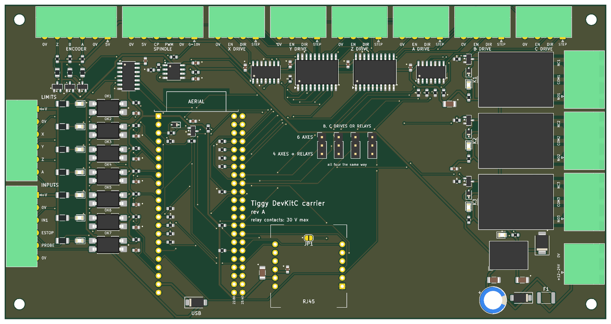

# Tiggy DevKitC carrier (revision A)

A carrier board for an **ESP32-S3-DevKitC-1** running the Tiggy firmware (environment `esp32s3-devkitc`, octal-memory modules such as N16R8), for either of the firmware's terminal layouts: **six axes**, or **four axes** with three relays, a charge pump and a spindle encoder. Four jumpers choose. KiCad 10 project, two layers, 182 x 95 mm.



> **Status: not yet built.** The schematic passes KiCad's electrical rule check and the routed board its design rule check (no violations, nothing unconnected, board and schematic in agreement), but no board has been made or powered. Check it against your own parts before ordering - above all the Ethernet module's pin order (below) and the relays.

## What is on it

| | |
|---|---|
| Controller | ESP32-S3-DevKitC-1 on two 22-pin sockets. A second row of holes takes the 25.4 mm wide boards sold under the same name. |
| Supply | 12 to 24 V DC (28 V is the regulator's absolute maximum), fused (resettable) and protected against reverse connection. A Recom R-78E5.0-1.0 makes 5 V; the DevKitC is fed through a diode, so its USB port never supplies the relays and the two supplies cannot fight. |
| Drives | Six plugs - X, Y, Z, A, B, C - each with STEP, DIR, EN and 0 V: 5 V push-pull outputs (74AHCT541 / 74AHCT125), a buffer of its own for every signal of every drive. B and C work with the jumpers set for six axes. |
| Jumpers | Four, side by side in the middle of the board: the B and C drives, or the relays and the charge pump ([below](#six-axes-or-four)). |
| Inputs | Seven opto-isolated inputs with an LED each: limit/home X, Y, Z, A, auxiliary input 1, E-stop, probe. A switch or an NPN sensor between the terminal and 0 V operates the input; the supply voltage is brought out for sensors. |
| Spindle sensor | Its own six-way plug: 5 V, 0 V, A, B, Z. Encoder with or without index, or a single sensor on Z. 5 V pull-ups (open-collector sensors connect directly), Schmitt triggers, good for the 250 000 lines a second the firmware reads. Without a sensor the three are auxiliary inputs 2 to 4. With six axes, A and B are the limit/home inputs of the B and C axes. |
| Outputs | Three relays (Omron G5LE-1, 5 V coil) on auxiliary outputs 1 to 3, each switched by a MOSFET so the coil gets its full 5 V; changeover contacts on three-way plugs, an LED each. With the jumpers set for four axes. |
| Spindle speed | The spindle PWM as 0 to 10 V for a frequency converter (needs 12 V or more at the supply terminal), and as a 5 V PWM signal. The charge pump output (four axes) is on the same plug. |
| Ethernet | Socket for a **USR-ES1** W5500 module (the "W5500 Lite", WIZ820io pin order). |

Plugs are Phoenix MC 1,5/..-G-3,81 (signals) and MSTBA 2,5/..-G-5,08 (supply, relays), or the many compatible "15EDG" parts.

## Six axes or four

The DevKitC has not the pins for six drives and for relays and an encoder as well, so the firmware has two terminal layouts, and six of the pins have a different job in each:

| DevKitC pin | Six axes | Four axes |
|---|---|---|
| GPIO 40 | B step | Relay 3 |
| GPIO 11 | B direction | Relay 1 |
| GPIO 39 | C step | Charge pump |
| GPIO 12 | C direction | Relay 2 |
| GPIO 16 | B limit/home (terminal A of the spindle sensor plug) | Encoder A, or auxiliary input 3 |
| GPIO 17 | C limit/home (terminal B of the spindle sensor plug) | Encoder B, or auxiliary input 4 |

The first four go through the jumper block (JP2 to JP5). Put **all four links towards `6 AXES`, or all four towards `4 AXES + RELAYS`**, and set the controller's terminal layout to the same: in the Mach3 plugin on the Terminals tab, otherwise with the protocol tester (`tools/protocol_test_gui.py`). The spindle sensor is chosen in the same place. A new controller is set for six axes.

Whichever side is not chosen is held off by pull-down resistors: with six axes the relays stay released and the charge pump terminal stays low; with four the B and C plugs are quiet.

If the links and the firmware do not agree nothing is damaged, but outputs do the wrong thing: links for six axes with the firmware on four puts the charge pump's square wave on the C drive's step input, and links for four with the firmware on six operates the relays whenever B or C moves. So set both before connecting anything to the B and C plugs or to the relays.

With six axes there is no charge pump, no relay and no encoder - the firmware has no pins left for them. A single sensor giving one pulse per turn still works, on terminal Z of the spindle sensor plug. The limit switches of B and C go on that plug's A and B terminals: a switch or an NPN sensor to 0 V, as on the other inputs, but these two are not opto-isolated.

## Which pin does what

| DevKitC pin | Function | | DevKitC pin | Function |
|---|---|---|---|---|
| GPIO 1 / 3 | X step / direction | | GPIO 5, 6, 7, 15 | Limit/home X, Y, Z, A |
| GPIO 2 / 4 | Y step / direction | | GPIO 18 | Auxiliary input 1 |
| GPIO 42 / 38 | Z step / direction | | GPIO 13 | E-stop |
| GPIO 41 / 10 | A step / direction | | GPIO 14 | Probe |
| GPIO 40 / 11 | B step / direction, or relays 3 and 1 | | GPIO 16, 17 | Encoder A, B (or auxiliary inputs 3, 4), or limit/home B, C |
| GPIO 39 / 12 | C step / direction, or charge pump and relay 2 | | GPIO 21 | Index / single sensor (or auxiliary input 2) |
| GPIO 8 | Drive enable | | GPIO 9 | Spindle PWM |
| GPIO 45, 46, 0, 47 | Ethernet MOSI, MISO, clock, interrupt | | | |

These are the firmware's own maps (`firmware/main/pin_config.h`, `pin_layout.c`) for its two terminal layouts, so no pin numbers have to be entered: only the layout is chosen.

## Four things done on purpose

- **Every drive's enable has a buffer of its own.** The firmware has one enable pin for all the drives, but a drive's enable input takes some 10 mA, and six of them are more than one logic output is rated for.
- **The Ethernet module is selected only after the ESP32 has left reset** (Q1, some 20 to 80 ms after the reset line goes high - long after the boot options are read, long before the firmware first talks to the module). The firmware has no pin for the module's chip select and expects it tied to 0 V. Tied there directly, the module drives its data output onto GPIO 46 all the time, and GPIO 46 is one of the pins the ESP32 reads as a boot option: left high it can stop the board entering download mode through the UART port. Solder jumper JP1 ties chip select to 0 V directly if you prefer the plain arrangement. The module's reset follows the ESP32's.
- **GPIO 0 has a pull-up** (4.7 k). It is the Ethernet clock, and the DevKitC has no pull-up of its own on it - only the one inside the chip - while it must be high at reset.
- **The outputs to the drives are held low while the ESP32 is in reset** (10 k on every buffer input), so no stray steps at power-on.

## Limits of this revision

- Relay contacts are laid out for **low voltage only** (tracks 1.2 mm, 1 mm clearance). Switch mains with an external relay or contactor.
- The spindle sensor inputs need a **74LVC14** (U4). A 74HC14 fits the footprint but is not 5 V tolerant on a 3.3 V supply.
- With six axes the limit/home inputs of B and C are the spindle sensor's inputs: protected like them (24 V on a terminal does no harm), but not opto-isolated.
- A short on the 5 V sensor supply resets the board (the regulator limits the current); there is no separate fuse for it.
- With USB alone the ESP32 runs, but the drive outputs, relays and inputs need the 12-24 V supply.

## How the project is made

Everything is generated from [`gen/design.py`](gen/design.py), which holds the circuit (every part, every net) and where each part sits:

```
python gen/build.py --tracklayer path/to/Tracklayer
```

writes the project's own library (the two module sockets), the schematic, runs KiCad's electrical rule check, exports the netlist and compares it with `design.py`, places the parts on the board from that netlist, routes it with [Tracklayer](https://github.com/MichaelGaylor/Tracklayer), fills the copper pours, joins with a via any patch of the 0 V pour that the tracks have cut off from the rest, and runs KiCad's design rule check with the schematic compared against the board. The build ends with an error if any of the checks finds a fault. Reports are written to `build/`. It needs KiCad 10 (`kicad-cli` and the Python that comes with it; where KiCad is not in `C:\Program Files\KiCad\10.0`, set `KICAD_BIN` and `KICAD_SHARE` to its `bin` and `share/kicad` directories) and takes about twenty minutes, nearly all of it routing. `--keep-routing` reuses the last routing when no pad has moved and nothing is connected differently.

The schematic has a page for each function - controller, supply, drives, the B and C drives with the jumpers, drive enable, inputs, spindle sensor, relays, spindle speed, Ethernet - each drawn as a circuit, with wires. A name in a pointed box is a signal that goes to another page; the page it goes to is written beside it. Where each part is drawn is in [`gen/gen_sch.py`](gen/gen_sch.py); what it is connected to stays in `design.py`, and the build fails if the drawing and `design.py` ever disagree about a single pin. Hand edits to a `.kicad_sch` or to the `.kicad_pcb` are lost at the next build: change the two files in `gen/`, or stop using the generator and carry on in KiCad.

Dimensions used for the sockets: Espressif's drawing of the ESP32-S3-DevKitC-1 v1.1 (25.40 x 62.74 mm, rows 22.86 mm apart, last pin 8.00 mm from the USB end) and USR IOT's data sheet of the USR-ES1 (two rows of six pins 20.32 mm apart; left row seen from above with the socket away from you: GND, GND, MOSI, SCLK, SCS, INT; right row: GND, 3.3 V, 3.3 V, NC, RST, MISO).
